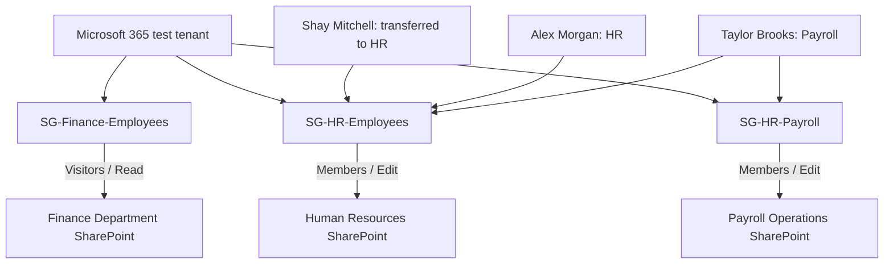

# Microsoft 365 Identity & Access Management Lab

**RiveraTechProtection | Simulated enterprise administration and authorization case study | November 2026**

> **Lab simulation:** All employees, finance figures, payroll records and workflows are fictitious. The tenant was created for training; this is not a production deployment or independently certified security assessment.

## Project overview

I configured a Microsoft 365 Business Premium trial tenant to demonstrate the employee identity lifecycle, least-privilege permissions, access revocation during a departmental transfer, and restricted access to sensitive resources within a department. I verified controls through SharePoint permission checks and separate test-user browser sessions.

**Tools:** Microsoft 365 Admin Center, Microsoft Entra ID security groups, SharePoint Online, Word for the web, private browser sessions.

## Business problem

Finance, general Human Resources and Payroll personnel require different resource access. Unauthorized employees should not inherit access solely because they work in the same company or department. A transferring employee should lose obsolete access and gain only the resources required for the new role.

## Architecture

**Important:** A security-group membership alone does not grant resource access. Each Entra security group was explicitly connected to an appropriate SharePoint permission group. Microsoft 365 group-connected sites also have their own site/group ownership structures.

## Tested scenarios

| Scenario | Expected | Observed evidence |
|---|---|---|
| Finance, Shay before transfer | Read | SharePoint effective permission **Read** and Word **View-only** |
| Finance, Alex | None | SharePoint effective permission **None** |
| Transfer, Shay leaves Finance | Revoke Read | Finance group membership removed; effective permission **None**; site denial tested |
| HR, Shay and Alex | Edit | Both show **Edit**; document revision visible in both sessions |
| Payroll, Taylor | Edit | Effective permission **Edit**; private site and document editing validated; revision saved |
| Payroll, Shay | None | Effective permission **None** and direct site-access denial |
| Payroll, Alex | None | Effective permission **None** (administrative check; no direct browser denial recorded) |

## Implementation summary

1. Created fictional standard-user identities, assigned trial licenses, and configured security groups.
2. Created Finance Department SharePoint and granted `SG-Finance-Employees` **Read** via the site's Visitors group.
3. Validated Finance authorization using user-level effective permissions and a view-only report.
4. Simulated Shay Mitchell's Finance-to-HR transfer: removed obsolete group membership, added authorized HR membership, updated personnel details, and retested permissions.
5. Created Human Resources SharePoint, granted `SG-HR-Employees` **Edit**, and validated collaborative editing of a fictional onboarding SOP.
6. Created `SG-HR-Payroll` for a specialized Payroll role, used a separate private Payroll Operations site, and granted only the specialized group Edit access.
7. Verified Taylor's authorized Payroll work and Shay's denied access from a different user session.

## Evidence

See [`evidence/`](evidence/) and [`docs/EVIDENCE_INDEX.md`](docs/EVIDENCE_INDEX.md) for numbered screenshots and precise descriptions. Key before/after comparisons:

- [Finance — Shay Read](evidence/07-finance-shay-read.png) → [Finance — Shay denied](evidence/12-finance-revoked.png)
- [HR — Shay Edit](evidence/14-hr-shay-edit.png) and [HR — Alex Edit](evidence/15-hr-alex-edit.png)
- [Payroll — Taylor Edit](evidence/22-payroll-taylor-edit.png) vs. [Shay None](evidence/23-payroll-shay-none.png) and [Alex None](evidence/24-payroll-alex-none.png)
- [Payroll — Taylor saves revision](evidence/27-payroll-saved-revision.png) and [Shay is denied](evidence/28-payroll-shay-denied.png)

## Security design decisions

- **Least privilege:** Grant Read to Finance document consumers; Edit to employees who maintain HR/Payroll documents.
- **Separation of access:** Payroll is isolated behind its own group and private SharePoint site instead of treating all HR employees as authorized.
- **Lifecycle management:** Revocation tested during department transfer, not only new access provisioning.
- **Positive and negative tests:** Effective permission checks were paired with browser tests wherever available.

## Scope and limitations

- This is a lab, not an independently audited production system; no real payroll data was used.
- No Microsoft Purview sensitivity label deployment, Conditional Access configuration, MFA enforcement test or automated provisioning is claimed.
- Several group screenshots show **zero group owners**. A production deployment would assign accountable owners and review membership regularly.
- SharePoint's effective-permissions checks are site-level evidence, not a substitute for a comprehensive file-sharing-link audit.
- SharePoint **Edit** may include delete and other modification capabilities. In production, validate actual duties, use narrower permission levels where justified, and apply additional controls to sensitive records.
- Final test-user sign-in evidence demonstrates the described behavior at the time of testing, not a permanent security guarantee.

## Artifacts

- [`docs/Q4-Financial-Report-TEST.pdf`](docs/Q4-Financial-Report-TEST.pdf) — sample Finance report with fictional amounts.
- [View Payroll Operations Report (PDF)](docs/RTP_Payroll_Operations_Report_TEST.pdf)
- [`docs/WEBSITE_CASE_STUDY.md`](docs/WEBSITE_CASE_STUDY.md) — short website copy.

## What I learned

Effective identity and access management connects business roles to resource-level permissions. Assigning a user to an organizational group is not enough: the group must be authorized on the target resource. The most important validation is comparing what an account **should** access against what it **actually** accesses, especially after role changes.
